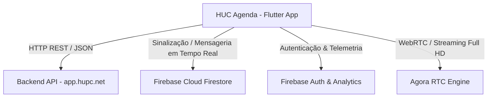

# 🩺 HUC Agenda (Hemp Up Caring)

> **Aplicativo móvel desenvolvido em Flutter para gestão de consultas médicas, prontuários, prescrições e telemedicina em tempo real (áudio e vídeo).**

---

## 📌 Sumário
- [1. Visão Geral](#1-visão-geral)
- [2. Stack Tecnológica Principal](#2-stack-tecnológica-principal)
- [3. Serviços em Nuvem e Backend (BaaS / APIs)](#3-serviços-em-nuvem-e-backend-baas--apis)
- [4. Catálogo Detalhado de Dependências (pubspec.yaml)](#4-catálogo-detalhado-de-dependências-pubspecyaml)
- [5. Arquitetura e Organização de Pastas](#5-arquitetura-e-organização-de-pastas)
- [6. Módulos de Domínio da Aplicação](#6-módulos-de-domínio-da-aplicação)
- [7. Permissões e Integrações de Hardware](#7-permissões-e-integrações-de-hardware)
- [8. Ferramentas de Build e Automação](#8-ferramentas-de-build-e-automação)
- [9. Como Configurar e Executar o Projeto](#9-como-configurar-e-executar-o-projeto)
- [10. Observações Técnicas e Compatibilidade](#10-observações-técnicas-e-compatibilidade)

---

## 1. Visão Geral

O **HUC Agenda** é uma solução de saúde digital criada para a plataforma **Hemp Up Caring**. O objetivo central do projeto é conectar médicos e pacientes através de uma plataforma integrada que engloba:
- Agendamento e gerenciamento de consultas com controle de status.
- Teleconsultas com chamadas de vídeo e áudio em tempo real com baixa latência.
- Sistema de sinalização de chamadas com tela de recebimento (*pickup screen*).
- Troca de mensagens e chat médico-paciente.
- Gestão de prescrições de medicamentos, patologias, áreas médicas e fichas de anamnese.
- Perfis diferenciados para clientes (pacientes) e profissionais da saúde (médicos).

---

## 2. Stack Tecnológica Principal

| Tecnologia | Versão / Configuração | Descrição |
| :--- | :--- | :--- |
| **Flutter SDK** | Canal estável (SDK Flutter) | Framework multiplataforma baseado em widgets reativos para Android e iOS. |
| **Dart SDK** | `>=2.7.0 <3.0.0` | Linguagem fortemente tipada utilizada na construção do app. |
| **Kotlin** | `1.5.0` | Linguagem de suporte nativo na camada Android (`android/app/src/main/kotlin`). |
| **Gradle** | `7.3` (Wrapper) | Sistema de automação de compilação nativa Android. |
| **Android Gradle Plugin (AGP)** | `4.2.0` | Plugin oficial do Gradle para compilação do ecossistema Android. |
| **Android SDK** | Min: `21` (Lollipop) \| Target: `30` (Android 11) \| Compile: `28` | Níveis de compatibilidade do sistema operacional Android. |

---

## 3. Serviços em Nuvem e Backend (BaaS / APIs)

O ecossistema do aplicativo opera através de uma arquitetura híbrida de backends:



### 1. **Agora RTC Engine (Telemedicina & Streaming de Vídeo)**
- **Biblioteca**: `agora_rtc_engine: ^4.0.7`
- **Identificador de App**: Configurado em `lib/configs/agora_configs.dart`.
- **Funcionalidades**:
  - Streaming de áudio e vídeo de alta fidelidade com taxa adaptativa.
  - Configuração de perfil de vídeo em alta resolução (dimensões Full HD `1920x1080`).
  - Funções de alternar câmera (frontal/traseira) e mutar/desmutar microfone.
  - Suporte a papéis de transmissão (`ClientRole.Broadcaster`).
  - Habilitação de interoperabilidade com Web SDK (`enableWebSdkInteroperability`).

### 2. **Google Firebase (BaaS & Tempo Real)**
- **`firebase_core: ^1.10.0`**: Núcleo de inicialização dos serviços Firebase (`Firebase.initializeApp()`).
- **`cloud_firestore: ^3.1.0`**: Banco de dados NoSQL reativo orientado a documentos. Utilizado para:
  - Gerenciamento de eventos de chamada ativa (estabelecer chamada, recusar e encerrar chamada).
  - Escuta reativa de chamadas recebidas através de streams para renderização do `PickupScreen`.
  - Histórico de mensagens e chat em tempo real entre médico e paciente.
- **`firebase_auth: ^3.2.0`**: Gestão de identidade e autenticação de usuários.
- **`firebase_analytics: ^8.3.4`**: Rastreamento de telemetria, eventos e comportamento do aplicativo.

### 3. **API REST Própria (HUC Backend)**
- **Host Base**: `https://app.hupc.net` (definido em `lib/src/app/com/hempupcaring/agenda/util/constantsAPI.dart`).
- **Comunicação**: Via chamadas HTTP (`package:http/http.dart`).
- **Dados Gerenciados**:
  - Catálogo de médicos e clientes.
  - Vínculos e relações cliente-médico.
  - Gestão e aprovação de consultas e agendamentos.
  - Cadastro de horários de atendimento.
  - Prescrição de medicamentos e emissão de receitas.
  - Consulta de municípios e áreas de atuação.
  - Paginação padronizada via `Metadata`, `ResultSet` e `Response`.

---

## 4. Catálogo Detalhado de Dependências (`pubspec.yaml`)

### Dependências de Produção (`dependencies`)

| Pacote | Versão | Função no Projeto |
| :--- | :--- | :--- |
| **`agora_rtc_engine`** | `^4.0.7` | Motor de chamadas de vídeo e áudio em tempo real (WebRTC/RTC). |
| **`cloud_firestore`** | `^3.1.0` | Banco de dados NoSQL em tempo real para chat e sinalização de chamadas. |
| **`firebase_core`** | `^1.10.0` | Biblioteca base obrigatória para conexão com o ecossistema Firebase. |
| **`firebase_auth`** | `^3.2.0` | Autenticação e controle de sessões Firebase. |
| **`firebase_analytics`** | `^8.3.4` | Monitoramento e analytics de eventos do aplicativo. |
| **`http`** | `^0.13.3` | Cliente HTTP para consumir as rotas REST do backend (`https://app.hupc.net`). |
| **`shared_preferences`** | `^2.0.6` | Armazenamento persistente local (chave-valor) para tokens, identificadores de usuário e perfis (ex: flag `isMedico`). |
| **`permission_handler`** | `^8.1.6` | Gestão dinâmica de permissões de Câmera e Microfone em tempo de execução no Android e iOS. |
| **`image_picker`** | `^0.7.5+3` | Seleção de imagens da galeria e captura de fotos pela câmera (fotos de perfil, comprovantes e receitas). |
| **`mask_text_input_formatter`** | `^2.0.0` | Formatação e aplicação de máscaras em campos de texto (CPF, telefones, datas, CRM). |
| **`cpfcnpj`** | `^1.0.3` | Utilitários de validação e formatação matemática para documentos brasileiros (CPF e CNPJ). |
| **`flutter_multiselect`** | `^0.5.0` | Widget para seleção múltipla em formulários (patologias do cliente, especialidades médicas). |
| **`intl`** | `^0.17.0` | Internacionalização, formatação de datas (`DateFormat`), parsing de horários e números. |
| **`cupertino_icons`** | `^1.0.3` | Biblioteca de ícones no estilo gráfico do iOS / Apple. |

### Dependências de Desenvolvimento (`dev_dependencies`)

| Ferramenta | Versão | Função |
| :--- | :--- | :--- |
| **`flutter_test`** | SDK Flutter | Framework nativo de testes unitários e de widgets. |
| **`flutter_launcher_icons`** | `^0.9.2` | Ferramenta de linha de comando para gerar e configurar ícones de inicialização do app automaticamente. |

---

## 5. Arquitetura e Organização de Pastas

O código-fonte está estruturado sob a raiz `lib/`, adotando o padrão de nomenclatura de domínio de pacotes (`com.hempupcaring.agenda`):

```
lib/
├── configs/
│   └── agora_configs.dart         # Credenciais do SDK da Agora (APP_ID)
├── src/
│   ├── customcolor.dart           # Paleta de cores temática do app (CustomColors.hucTheme)
│   └── app/
│       └── com/
│           └── hempupcaring/
│               └── agenda/
│                   ├── autenticacaoResponse.dart  # DTO de resposta de autenticação
│                   ├── metadata.dart              # Metadados de paginação
│                   ├── response.dart              # Estrutura base de resposta de API
│                   ├── resultSet.dart             # Estrutura de listagem de resultados
│                   ├── sca/                       # Módulo: Sistema de Controle de Acesso
│                   ├── scc/                       # Módulo: Sistema de Comunicação e Chamadas
│                   ├── scl/                       # Módulo: Sistema de Localização / Municípios
│                   ├── scs/                       # Módulo: Sistema de Consultas e Saúde
│                   └── util/                      # Utilitários, constantes de API e datas
├── widgets/
│   ├── expansion-panel.dart       # Componente de painel expansível customizado
│   └── nav-drawer.dart            # Menu lateral de navegação contextual (Médico vs Paciente)
└── main.dart                      # Ponto de entrada (inicialização do Firebase e runApp)
```

---

## 6. Módulos de Domínio da Aplicação

### 🔐 1. SCA — Sistema de Controle de Acesso (`lib/.../sca/`)
Responsável pela segurança, controle de identidade e dados cadastrais dos usuários.
- **Modelos (`model/`)**: `usuarioModel.dart`, `clienteModel.dart`, `medicoModel.dart`, `relacaoClienteMedicoModel.dart`.
- **Telas (`pages/`)**:
  - `entrar.page.dart`: Tela de login com validação de credenciais.
  - `cadastro.page.dart`: Cadastro de novos usuários.
  - `perfil.page.dart`: Edição de perfil do usuário logado.
  - `profissional.page.dart`: Gestão dos dados profissionais do médico.
  - `redefinirsenha.page.dart`: Recuperação e troca de senhas.
  - `clienteRelacaoClienteMedico.page.dart` & `medicoRelacaoClienteMedico.page.dart`: Gestão da relação contratual e clínica entre médicos e pacientes.
- **Serviços (`services/`)**: `autenticacao.service.dart`, `usuario.service.dart`, `medico.service.dart`, `cliente.service.dart`, `relacaoClienteMedico.service.dart`.

### 📞 2. SCC — Sistema de Comunicação e Chamadas (`lib/.../scc/`)
Módulo responsável pelas teleconsultas e comunicação interativa em tempo real.
- **Modelos (`model/`)**: `chamada.model.dart`, `chat.model.dart`, `mensagem.model.dart`, `areaModel.dart`, `patologiaModel.dart`, `fichaAnamneseModel.dart`.
- **Telas (`pages/`)**:
  - `form/chamada.page.form.dart`: Tela de videoconferência integrada com Agora RTC Engine.
  - `form/pickup/`: Telas de recepção de chamada (`pickup_screen.dart` e `pickup_layout.dart`) com alerta sonoro e botões de atender/rejeitar.
  - `form/mensagem.page.form.dart`: Tela de envio e visualização de mensagens no chat.
  - `area.page.dart` & `patologia.page.dart`: Configuração de áreas médicas e patologias tratadas.
- **Serviços (`services/`)**: `chamada.service.dart` (Firestore), `chat.service.dart`, `mensagem.service.dart`.

### 🩺 3. SCS — Sistema de Consultas e Saúde (`lib/.../scs/`)
Gerencia o fluxo clínico do agendamento, atendimento e receituário.
- **Modelos (`model/`)**: `consulta.model.dart`, `horarioAtendimentoModel.dart`, `prescricaoMedicamento.model.dart`, `consultaStatus.model.dart`.
- **Telas (`pages/`)**:
  - `list/consulta.page.list.dart`: Listagem das consultas agendadas, finalizadas ou pendentes.
  - `form/consulta.page.form.dart`: Agendamento e edição de consultas.
  - `horarioAtendimentoList.page.dart`: Grade de horários disponíveis para atendimento médico.
  - `list/prescricaoMedicamento.page.list.dart` & `form/prescricaoMedicamento.page.form.dart`: Emissão e histórico de receitas e medicamentos prescritos.
- **Serviços (`services/`)**: `consulta.service.dart`, `horarioAtendimento.service.dart`, `prescricaoMedicamento.service.dart`.

### 📍 4. SCL — Sistema de Cadastros e Localização (`lib/.../scl/`)
- **Serviços (`services/`)**: `municipio.service.dart` para listagem e preenchimento de endereços de cidades e estados.

---

## 7. Permissões e Integrações de Hardware

O aplicativo interage diretamente com hardware do dispositivo móvel para permitir teleconsultas e envio de documentos.

### Android (`android/app/src/main/AndroidManifest.xml`)
- `android.permission.INTERNET`: Comunicação com API REST, Firestore e Agora RTC.
- `android.permission.CAMERA`: Captura de vídeo na teleconsulta e fotos de receitas.
- `android.permission.RECORD_AUDIO`: Captura do microfone para teleconferência.
- `android.permission.MODIFY_AUDIO_SETTINGS`: Controle dinâmico do alto-falante e fone durante chamadas.
- `android.permission.ACCESS_NETWORK_STATE`: Verificação da estabilidade da conexão de rede.
- `android.permission.BLUETOOTH`: Suporte ao roteamento de áudio via fones de ouvido Bluetooth.
- `android.permission.READ_PHONE_STATE`: Detecção de chamadas telefônicas convencionais concorrentes.

### iOS (`ios/Runner/Info.plist`)
Para compilações em iOS, são necessárias as descrições de privacidade no `Info.plist`:
- `NSCameraUsageDescription`: Acesso à câmera para teleconsultas e envio de imagens.
- `NSMicrophoneUsageDescription`: Acesso ao microfone durante a videoconferência.
- `NSPhotoLibraryUsageDescription`: Escolha de imagens na galeria.

---

## 8. Ferramentas de Build e Automação

### Geração de Ícones do Aplicativo
O projeto utiliza o pacote `flutter_launcher_icons` configurado no `pubspec.yaml` para gerar os ícones do Android a partir da imagem original em `assets/logo_escura.jpg`:
```bash
flutter pub run flutter_launcher_icons:main
```

### Chaves de Assinatura (Release)
O arquivo `android/app/build.gradle` possui suporte nativo à leitura de chaves de assinatura a partir do arquivo `key.properties` (`keyAlias`, `keyPassword`, `storeFile`, `storePassword`).

---

## 9. Como Configurar e Executar o Projeto

### Pré-requisitos
1. **Flutter SDK**: Versão compatível com Dart 2 (ex: Flutter 1.22.x ou 2.x com compatibilidade pre-null safety).
2. **Java JDK**: JDK 8 ou 11 para compatibilidade com o Gradle 7.3.
3. **Android Studio / VS Code**: Com extensões de Flutter e Dart instaladas.
4. **Dispositivo Físico ou Emulador**: Recomenda-se um dispositivo físico com câmera e microfone funcionais para testar as chamadas de vídeo.

### Passo a Passo

1. **Obter as dependências**:
   ```bash
   flutter pub get
   ```

2. **Verificar a integridade do ambiente**:
   ```bash
   flutter doctor
   ```

3. **Configuração do Firebase**:
   - Para Android: certifique-se de que o arquivo `android/app/google-services.json` está presente.
   - Para iOS: adicionar o arquivo `GoogleService-Info.plist` no diretório `ios/Runner/` via Xcode.

4. **Configuração da Agora.io**:
   - Caso deseje utilizar credenciais próprias, altere a chave `APP_ID` em:
     ```dart
     // lib/configs/agora_configs.dart
     const String APP_ID = "SEU_APP_ID_AQUI";
     ```

5. **Executar em modo desenvolvimento**:
   ```bash
   flutter run
   ```

6. **Gerar pacote para distribuição (Android APK)**:
   ```bash
   flutter build apk --release
   ```

---

## 10. Observações Técnicas e Compatibilidade

> [!NOTE]
> **Versão do Dart (Null Safety)**: O projeto utiliza a restrição de SDK `sdk: ">=2.7.0 <3.0.0"`. Caso seja executado em versões recentes do Flutter (Flutter 2.10+ ou Flutter 3.x), pode ser necessário executar com a flag `--no-sound-null-safety` caso não seja feita a migração das dependências legadas.

> [!IMPORTANT]
> **Permissões em Tempo Real**: As chamadas de vídeo exigem permissão explícita em tempo de execução via `permission_handler`. Se o usuário negar permissão de câmera ou microfone, a tela de chamada de vídeo (`ChamadaPageForm`) não será inicializada.
